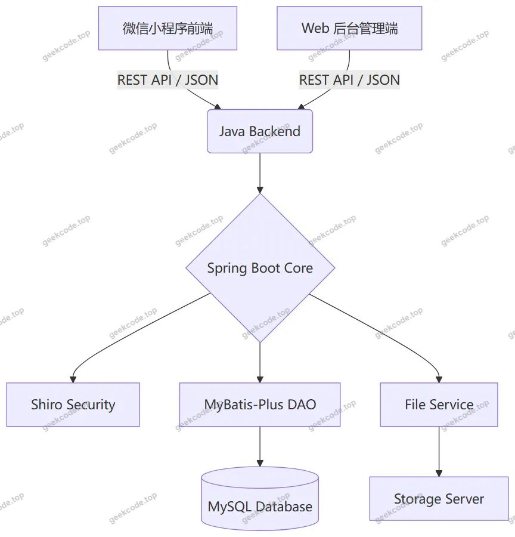
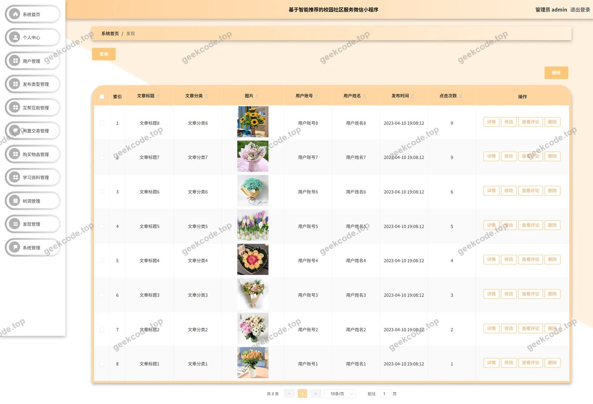
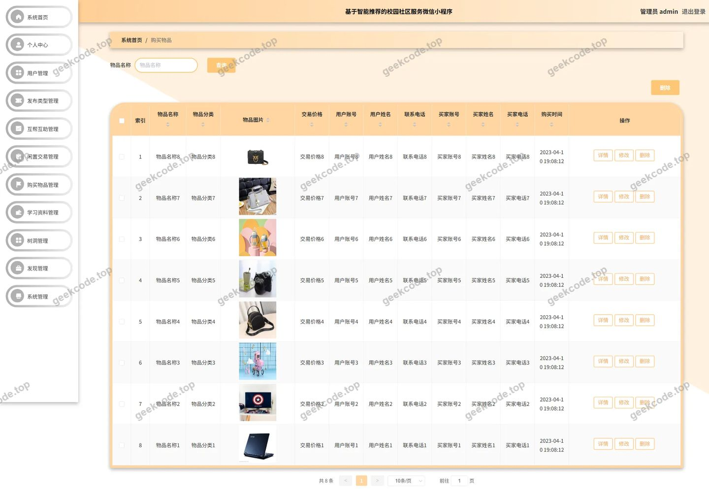
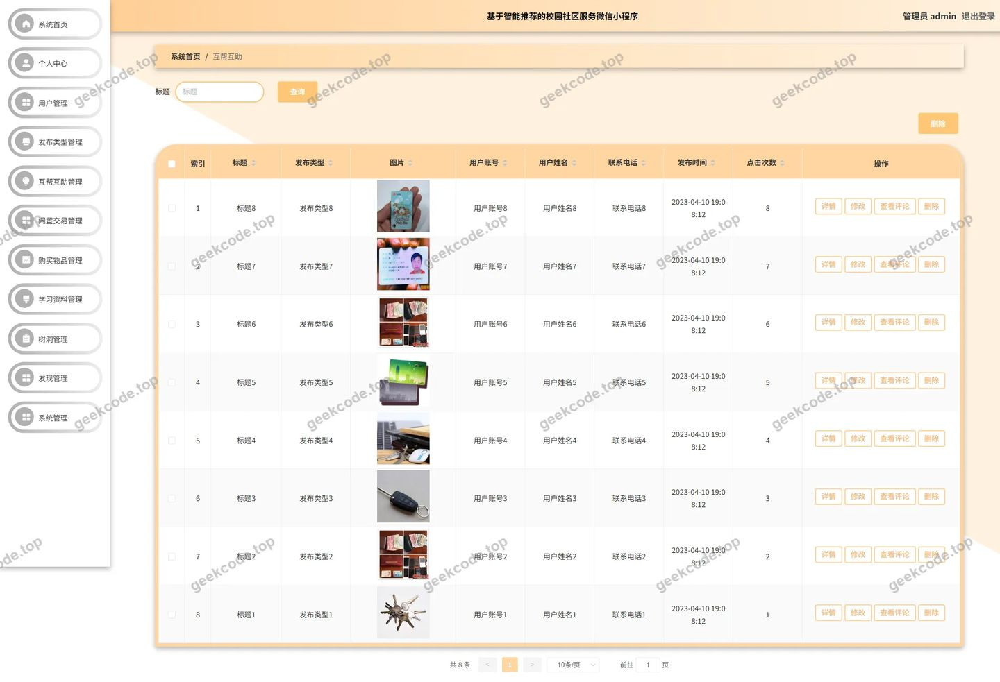
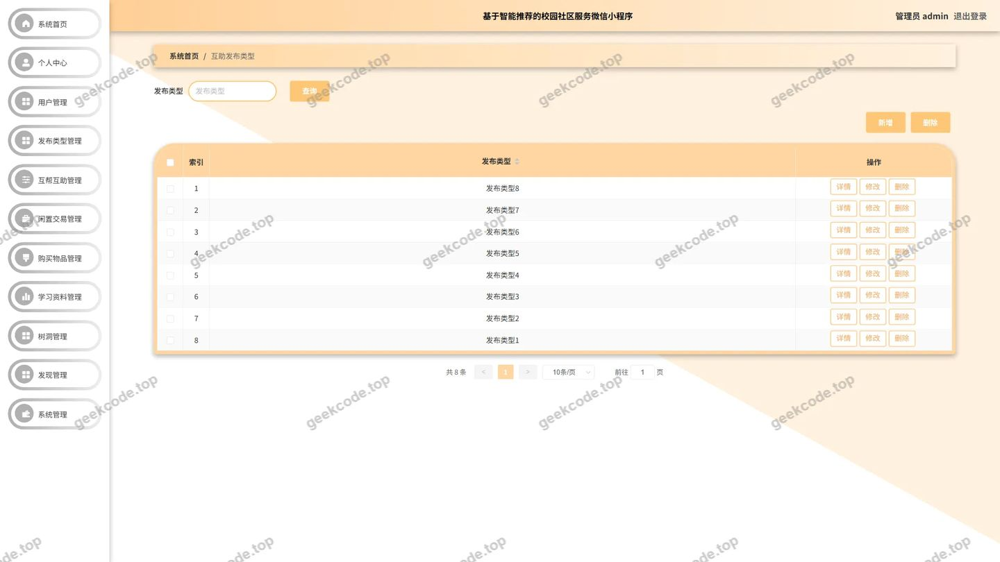
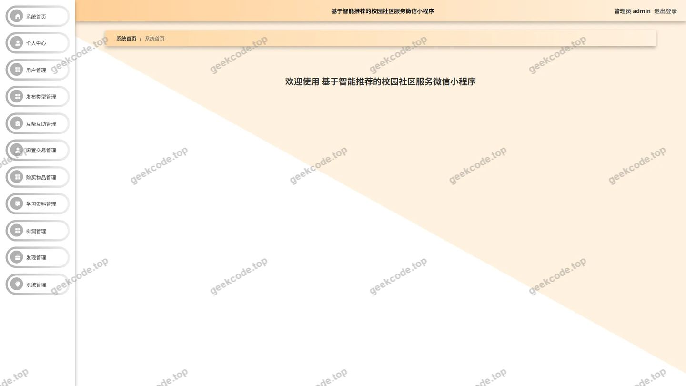
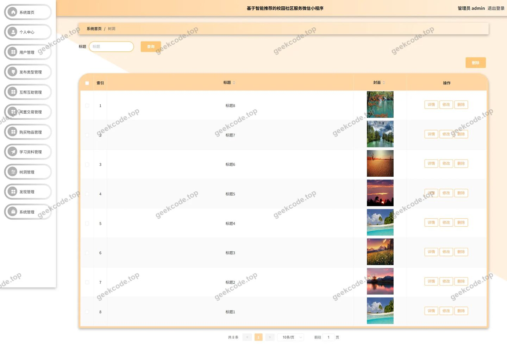
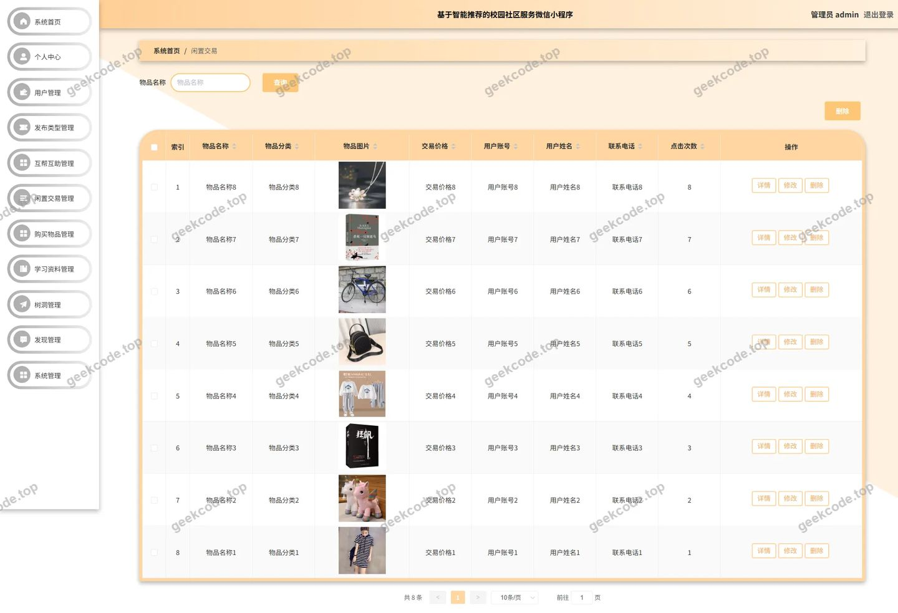

# 基于智能推荐的校园社区服务微信小程序5x8ot

> 🎓 **计算机毕业设计 · 基于智能推荐的校园社区服务微信小程序5x8ot**
>
> 本仓库只放**项目介绍 + 运行截图**（截图是站点带水印的原图，存在仓库 `images/` 里）。
>
> 👉 **完整可运行源码 / 数据库脚本 / 部署文档：[点我获取](https://geekcode.top/archives/%E5%9F%BA%E4%BA%8E%E6%99%BA%E8%83%BD%E6%8E%A8%E8%8D%90%E7%9A%84%E6%A0%A1%E5%9B%AD%E7%A4%BE%E5%8C%BA%E6%9C%8D%E5%8A%A1%E5%BE%AE%E4%BF%A1%E5%B0%8F%E7%A8%8B%E5%BA%8F5x8ot?utm_source=github)**
>
> 💬 咨询微信：**ir9372**　|　🌐 更多项目：[极客代码 geekcode.top](https://geekcode.top/?utm_source=github)
>
> 📌 项目详情页：<https://geekcode.top/archives/%E5%9F%BA%E4%BA%8E%E6%99%BA%E8%83%BD%E6%8E%A8%E8%8D%90%E7%9A%84%E6%A0%A1%E5%9B%AD%E7%A4%BE%E5%8C%BA%E6%9C%8D%E5%8A%A1%E5%BE%AE%E4%BF%A1%E5%B0%8F%E7%A8%8B%E5%BA%8F5x8ot?utm_source=github>

<table><td width="230" align="center"> <b>扫码加微信 ir9372</b></td><td valign="middle">📦 源码 = 项目介绍 + 全部运行截图 + 数据库 + 部署文档 👉 点上方任意截图，直接跳到 <b>极客代码 geekcode.top</b> 详情页</td></table>

---

<h1>基于智能推荐的校园社区服务微信小程序_5x8ot</h1>
<h2>项目概述</h2>

本项目名为“基于智能推荐的校园社区服务微信小程序”，旨在构建一个集闲置交易、互帮互助、学术交流及生活分享于一体的综合性校园服务平台。项目采用前后端分离架构，前端以微信小程序为载体，后端基于 Java 技术栈开发，通过 RESTful API 实现数据交互。核心功能涵盖闲置物品发布与购买、学习资源共享、树洞情感倾诉、发现页内容浏览以及在线客服咨询等模块。系统面向在校大学生群体，解决校园内信息不对称、资源流通效率低及社交互动缺乏等问题。后台管理端提供完善的数据维护与权限控制能力，确保平台内容的合规性与安全性。整体架构轻量高效，具备良好的扩展性与用户体验。

<h2>技术架构</h2>

本项目采用经典的前后端分离架构设计，具体技术选型如下：

<strong>1. 后端架构</strong>
后端服务基于 Spring Boot 框架构建，利用其自动配置特性简化部署流程。持久层采用 MyBatis-Plus 作为 ORM 框架，配合 MySQL 数据库进行数据存储与管理，通过 <code>mybatis-spring-boot-starter</code> 和 <code>mysql-connector-java</code> 实现高效的数据访问。安全认证与授权机制引入 Apache Shiro（依赖 <code>shiro-spring</code>），用于处理用户身份验证及接口权限控制。此外，集成 <code>commons-lang3</code> 工具类库增强代码健壮性，并使用 <code>validation-api</code> 进行参数校验。

<strong>2. 前端架构</strong>
前端主要包含两个部分：

<ul>
<li><strong>微信小程序端</strong>：作为用户主要交互入口，负责展示首页、闲置交易、互帮互助、学习资料、树洞、发现等功能页面，并通过 HTTP 请求调用后端接口获取动态数据。</li>
<li><strong>Web 后台管理端</strong>：供管理员使用，提供对各类业务数据的增删改查及系统配置管理功能。</li>
</ul>

<strong>3. 交互方式</strong>
小程序前端与 Java 后端之间通过标准的 RESTful API 进行通信。后端 Controller 层接收 JSON 格式的请求数据，经过业务逻辑处理后返回统一格式的响应结果，前端解析数据并渲染界面。

<h2>功能模块</h2>

根据源码中的 Controller 列表、路由配置及截图所示功能，系统主要划分为以下两大模块：

<h3>1. 微信小程序用户端</h3>

小程序端面向普通注册用户，提供便捷的移动端服务体验，主要功能包括：

<ul>
<li><strong>用户体系</strong>：支持用户注册、登录、个人信息查看与维护。</li>
<li><strong>闲置交易板块</strong>：</li>
<li><strong>闲置交易列表</strong>：浏览其他用户发布的二手物品。</li>
<li><strong>购买物品列表</strong>：查看待购买的物品需求或已购记录。</li>
<li><strong>物品分类</strong>：按类别筛选闲置商品。</li>
<li><strong>互帮互助板块</strong>：</li>
<li><strong>互帮互助列表</strong>：查看求助信息或提供帮助。</li>
<li><strong>互助发布类型</strong>：选择不同类型的互助需求进行发布。</li>
<li><strong>学术与资讯板块</strong>：</li>
<li><strong>学习资料列表</strong>：浏览和搜索共享的学习资料。</li>
<li><strong>资料类别</strong>：按学科或类型分类查看资料。</li>
<li><strong>发现页</strong>：浏览校园内的热门话题、文章或活动推荐。</li>
<li><strong>文章分类</strong>：对发现页内容进行细分浏览。</li>
<li><strong>社交与互动板块</strong>：</li>
<li><strong>树洞列表</strong>：匿名发表心情或秘密，参与社区讨论。</li>
<li><strong>在线客服 (Chat)</strong>：提供即时通讯功能，用户可与客服或其他用户沟通。</li>
<li><strong>评论互动</strong>：支持对闲置交易、互助信息、学习资料、发现内容及树洞帖子进行评论 (<code>discuss...</code>)。</li>
<li><strong>个人中心</strong>：</li>
<li><strong>我的收藏</strong>：查看收藏的闲置物品、文章或资料。</li>
<li><strong>菜单管理</strong>：用户端的个性化菜单设置。</li>
</ul>
<h3>2. Web 后台管理端</h3>

后台管理系统面向管理员，提供全量的数据管理与系统配置功能，主要路由及对应功能如下：

<ul>
<li><strong>基础信息管理</strong>：</li>
<li><code>/yonghu</code>：用户管理，查看、编辑、禁用用户账号。</li>
<li><code>/config</code>：系统配置管理，修改站点名称、Logo 等全局参数。</li>
<li><code>/menu</code>：菜单管理，配置后台导航结构。</li>
<li><strong>业务数据管理</strong>：</li>
<li><code>/xianzhijiaoyi</code>：闲置交易管理，审核、删除违规交易信息。</li>
<li><code>/goumaiwupin</code>：购买物品管理，监控求购订单状态。</li>
<li><code>/hubanghuzhu</code>：互帮互助管理，处理互助请求。</li>
<li><code>/huzhufabuleixing</code>：互助发布类型管理，维护互助分类字典。</li>
<li><code>/xuexiziliao</code>：学习资料管理，上传、审核学习资料。</li>
<li><code>/ziliaoleibie</code>：资料类别管理，维护资料分类体系。</li>
<li><code>/faxian</code>：发现内容管理，发布或审核校园资讯。</li>
<li><code>/wenzhangfenlei</code>：文章分类管理，维护资讯分类。</li>
<li><code>/wupinfenlei</code>：物品分类管理，维护闲置物品分类。</li>
<li><code>/shudong</code>：树洞管理，监管匿名社区内容。</li>
<li><strong>互动与客服管理</strong>：</li>
<li><code>/chat</code>：聊天记录管理，查看用户与客服或用户间的对话历史。</li>
<li><code>/discussxianzhijiaoyi</code>, <code>/discusshubanghuzhu</code>, <code>/discussxuexiziliao</code>, <code>/discussfaxian</code>：各模块评论管理，审核或删除不当评论。</li>
<li><code>/storeup</code>：收藏管理，查看用户收藏行为数据。</li>
</ul>
<h2>用户角色与权限</h2>

系统基于 Shiro 框架实现权限控制，主要涉及两类角色：

<h3>1. 普通用户 (Student/User)</h3>
<ul>
<li><strong>访问范围</strong>：仅限微信小程序前端。</li>
<li><strong>权限详情</strong>：</li>
<li><strong>读权限</strong>：浏览所有公开的业务列表（闲置、互助、资料、发现、树洞）、查看详情、阅读评论。</li>
<li><strong>写权限</strong>：注册账号、登录、修改个人信息、发布闲置物品、发起互助请求、上传学习资料、发布树洞内容、发表评论、收藏/取消收藏内容、使用在线客服聊天。</li>
<li><strong>限制</strong>：无法访问 Web 后台管理端，无法删除他人内容，无法修改系统配置。</li>
</ul>
<h3>2. 管理员 (Admin)</h3>
<ul>
<li><strong>访问范围</strong>：Web 后台管理端（及部分小程序管理视图）。</li>
<li><strong>权限详情</strong>：</li>
<li><strong>超级权限</strong>：拥有对所有业务数据的全量 CRUD（增删改查）权限。</li>
<li><strong>用户管理</strong>：可查看所有注册用户信息，执行封号、重置密码等操作。</li>
<li><strong>内容审核</strong>：可对闲置交易、互助信息、学习资料、发现文章、树洞帖子及其评论进行审核、下架或删除操作，确保社区内容合规。</li>
<li><strong>系统配置</strong>：可修改系统基础参数、菜单结构、分类字典（物品分类、资料类别、文章分类、互助类型）。</li>
<li><strong>日志与监控</strong>：可查看聊天记录、收藏统计等运营数据。</li>
</ul>
<h2>项目特色与创新点</h2>
<ol>
<li><strong>垂直领域的校园场景化服务</strong>：不同于通用的电商平台，本项目深度结合校园生活场景，将“闲置交易”、“学业互助”、“心理树洞”三大高频需求整合于单一小程序中，解决了学生群体在校园生活中资源分散、信任缺失的痛点。</li>
<li><strong>多维度的内容互动体系</strong>：引入了完整的评论机制 (<code>Discuss</code> 系列模块)，覆盖交易、互助、资料、资讯等多个维度，增强了社区的活跃度和用户粘性，形成了良好的UGC（用户生成内容）生态。</li>
<li><strong>即时通讯与客服融合</strong>：内置 Chat 模块，不仅支持用户间的直接沟通，还集成了在线客服功能，提升了交易撮合效率和用户问题解决速度，体现了服务的人性化设计。</li>
<li><strong>精细化的分类管理体系</strong>：针对闲置物品、学习资料、文章内容分别建立了独立的分类管理模块（如 <code>wupinfenlei</code>, <code>ziliaoleibie</code>, <code>wenzhangfenlei</code>），使得海量非结构化数据能够被有效组织和检索，提升了用户体验。</li>
<li><strong>安全稳定的技术底座</strong>：采用 Shiro 进行细粒度的权限控制，结合 MyBatis-Plus 的高效数据处理能力，保障了系统在多用户并发访问下的数据一致性和安全性。</li>
</ol>
<h2>部署环境</h2>

为确保项目正常运行，需准备以下软件环境：

<ol>
<li><strong>后端运行环境</strong>：</li>
</ol>
<ul>
<li><strong>JDK</strong>：版本建议 JDK 1.8 或以上，用于编译和运行 Spring Boot 应用。</li>
<li><strong>Maven</strong>：用于依赖管理和项目构建。</li>
<li><strong>MySQL</strong>：版本建议 5.7 或 8.0，用于存储业务数据。需创建对应的数据库实例并导入初始化 SQL 脚本。</li>
<li><strong>IDE</strong>：IntelliJ IDEA 或 Eclipse，用于后端代码开发与调试。</li>
</ul>
<ol start="2">
<li><strong>前端运行环境</strong>：</li>
</ol>
<ul>
<li><strong>微信开发者工具</strong>：最新版本，用于小程序前端的代码编写、预览、真机调试及打包发布。</li>
<li><strong>Node.js</strong>：若后台管理端涉及 Vue 工程化构建，需安装 Node.js 及 npm/yarn 包管理器。</li>
</ul>
<ol start="3">
<li><strong>其他依赖</strong>：</li>
</ol>
<ul>
<li><strong>文件存储服务</strong>：项目中包含 <code>FileController</code>，需配置本地磁盘路径或对接对象存储（如 OSS/COS）以支持图片上传功能。</li>
<li><strong>网络环境</strong>：服务器需开放相应端口（默认为 8080 或其他自定义端口），并确保小程序合法域名配置正确，以便正常调用后端 API。</li>
</ul>
<h2>五、技术特性</h2>
<ul>
<li>前后端集成部署，前端资源打包至后端 static 目录</li>
<li>使用 MyBatis-Plus 简化数据访问层开发</li>
<li>集成 Shiro 权限框架实现角色权限控制</li>
</ul>
<h2>六、功能模块截图</h2>
<h3>微信小程序用户端</h3>

<figure><figcaption>小程序-登录</figcaption></figure>
<figure><figcaption>小程序-发现</figcaption></figure>
<figure><figcaption>小程序-个人信息</figcaption></figure>
<figure><figcaption>小程序-购买物品列表</figcaption></figure>
<figure><figcaption>小程序-互帮互助</figcaption></figure>
<figure><figcaption>小程序-首页</figcaption></figure>
<figure><figcaption>小程序-树洞列表</figcaption></figure>
<figure><figcaption>小程序-我的</figcaption></figure>
<figure><figcaption>小程序-我的收藏列表</figcaption></figure>
<figure><figcaption>小程序-闲置交易列表</figcaption></figure>
<figure><figcaption>小程序-学习资料列表</figcaption></figure>
<figure><figcaption>小程序-在线客服</figcaption></figure>
<figure><figcaption>小程序-注册</figcaption></figure>

<h3>微信小程序管理端</h3>

<figure><figcaption>小程序-管理端-菜单列表</figcaption></figure>
<figure><figcaption>小程序-管理端-互助发布类型列表</figcaption></figure>
<figure><figcaption>小程序-管理端-文章分类列表</figcaption></figure>
<figure><figcaption>小程序-管理端-物品分类列表</figcaption></figure>
<figure><figcaption>小程序-管理端-用户列表</figcaption></figure>
<figure><figcaption>小程序-管理端-资料类别列表</figcaption></figure>

<h3>后台管理端</h3>
<h4>后台-登录页</h4>

<h4>后台-发现</h4>

<h4>后台-购买物品</h4>

<h4>后台-互帮互助</h4>

<h4>后台-互助发布类型</h4>

<h4>后台首页</h4>

<h4>后台-树洞</h4>

<h4>后台-闲置交易</h4>

---

## 获取完整源码

| 项目 | 说明 |
| --- | --- |
| 项目名 | 基于智能推荐的校园社区服务微信小程序5x8ot |
| 运行截图 | 本文 28 张（站点带水印原图，仓库 `images/` 目录） |
| 完整源码 | [https://geekcode.top/archives/%E5%9F%BA%E4%BA%8E%E6%99%BA%E8%83%BD%E6%8E%A8%E8%8D%90%E7%9A%84%E6%A0%A1%E5%9B%AD%E7%A4%BE%E5%8C%BA%E6%9C%8D%E5%8A%A1%E5%BE%AE%E4%BF%A1%E5%B0%8F%E7%A8%8B%E5%BA%8F5x8ot?utm_source=github](https://geekcode.top/archives/%E5%9F%BA%E4%BA%8E%E6%99%BA%E8%83%BD%E6%8E%A8%E8%8D%90%E7%9A%84%E6%A0%A1%E5%9B%AD%E7%A4%BE%E5%8C%BA%E6%9C%8D%E5%8A%A1%E5%BE%AE%E4%BF%A1%E5%B0%8F%E7%A8%8B%E5%BA%8F5x8ot?utm_source=github) |
| 咨询微信 | **ir9372**（备注：jingpin-yuanma） |
| 更多项目 | [极客代码 geekcode.top](https://geekcode.top/?utm_source=github) |

> 需要源码、部署、改配置、跑不起来等问题，加微信 ir9372 沟通，说明项目名即可。
